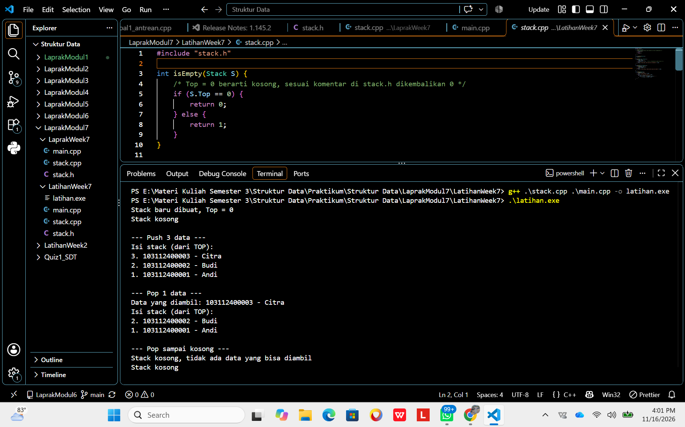
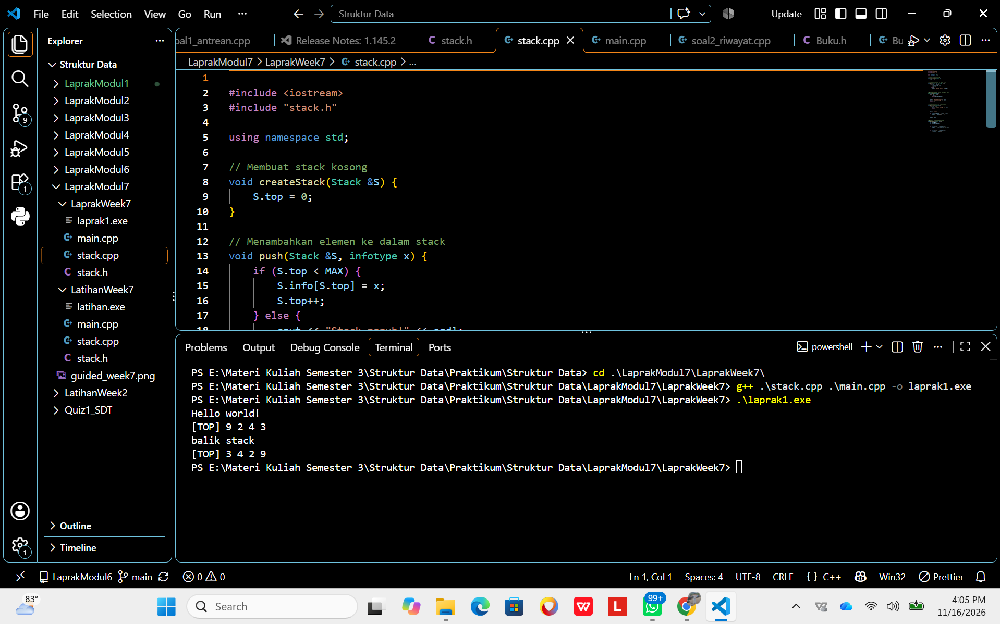
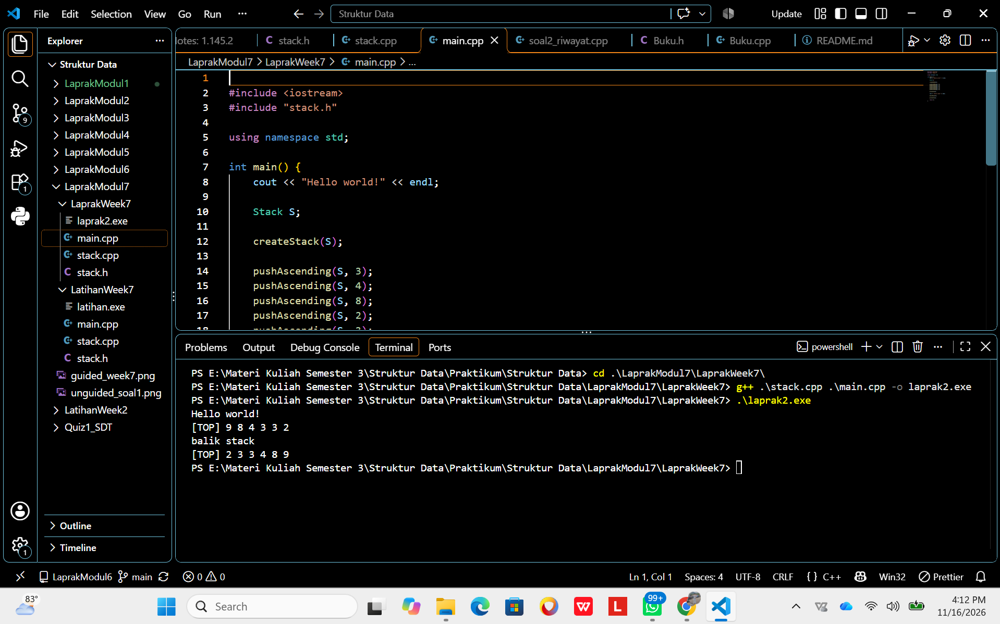
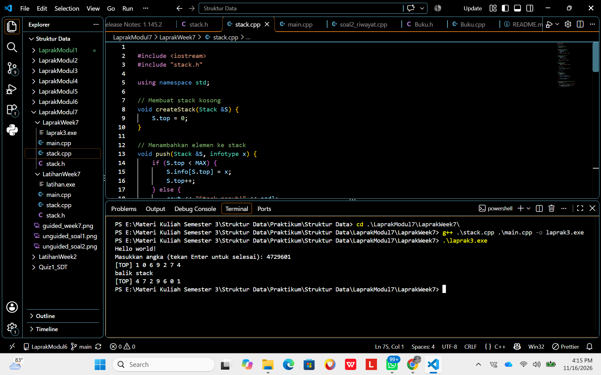

# Praktikum Struktur Data --- Modul 07: Stack

## Identitas Praktikum

-   **Mata kuliah:** Praktikum Struktur Data
-   **Materi:** Stack
-   **Modul:** 07
-   **Program studi:** S1 Informatika
-   **Institusi:** Telkom University
-   **Nama:** Rakhmat Pratama
-   **NIM:** 109082530037
-   **Kelas:** S1IF-13-01

------------------------------------------------------------------------

## Daftar Isi

-   [Pendahuluan](#pendahuluan)
-   [Tujuan Praktikum](#tujuan-praktikum)
-   [Konsep Materi](#konsep-materi)
-   [Bagian A --- Guided](#bagian-a--guided)
    -   [Deskripsi Guided](#deskripsi-guided)
    -   [Kode Guided](#kode-guided)
    -   [Cara Menjalankan Guided](#cara-menjalankan-guided)
    -   [Hasil Pengujian Guided](#hasil-pengujian-guided)
-   [Bagian B --- Unguided](#bagian-b--unguided)
    -   [Unguided 1 --- ADT Stack dengan
        Array](#unguided-1--adt-stack-dengan-array)
    -   [Unguided 2 --- pushAscending](#unguided-2--pushascending)
    -   [Unguided 3 --- getInputStream](#unguided-3--getinputstream)
-   [Kesimpulan](#kesimpulan)
-   [Daftar Pustaka](#daftar-pustaka)

------------------------------------------------------------------------

## Pendahuluan

Stack merupakan salah satu struktur data linear yang menerapkan prinsip
**LIFO (Last In, First Out)**, yaitu elemen yang terakhir dimasukkan
akan menjadi elemen pertama yang dikeluarkan. Penambahan dan penghapusan
elemen dilakukan melalui satu sisi yang disebut **TOP**. Operasi
penambahan disebut `push`, sedangkan operasi penghapusan disebut `pop`.

Pada Modul 07, stack dipelajari melalui representasi pointer dan
tabel/array. Dokumentasi praktikum ini berfokus pada Guided dari asisten
praktikum yang mengimplementasikan stack berbasis array untuk menyimpan
data NIM dan nama, serta tiga latihan Unguided yang mengimplementasikan
ADT Stack berbasis array integer. Ketiga Unguided mencakup operasi dasar
stack, penyisipan terurut menggunakan `pushAscending`, dan pembacaan
input menggunakan `getInputStream`.

## Tujuan Praktikum

1.  Memahami konsep stack dan prinsip LIFO.
2.  Memahami peran TOP sebagai penanda elemen teratas stack.
3.  Mengimplementasikan operasi dasar stack, yaitu pembuatan stack,
    pengecekan kondisi kosong, `push`, `pop`, dan penampilan isi stack.
4.  Mengimplementasikan ADT Stack menggunakan array.
5.  Memahami cara membalik urutan elemen stack.
6.  Mengimplementasikan prosedur `pushAscending` untuk menjaga susunan
    elemen secara ascending.
7.  Mengimplementasikan prosedur `getInputStream` untuk menerima input
    hingga pengguna menekan Enter.
8.  Memisahkan deklarasi, implementasi, dan program utama ke dalam file
    header, file implementasi, dan file utama.

## Konsep Materi

### 1. Pengertian Stack

Stack adalah struktur data linear yang hanya mengizinkan akses
penambahan dan penghapusan elemen melalui satu sisi, yaitu TOP. Karena
elemen terakhir yang dimasukkan berada di posisi teratas, elemen
tersebut akan dikeluarkan terlebih dahulu.

### 2. Prinsip LIFO

LIFO merupakan singkatan dari *Last In, First Out*. Contohnya, jika
elemen `A`, `B`, lalu `C` dimasukkan ke stack, urutan pengambilan
elemennya adalah `C`, `B`, kemudian `A`.

### 3. TOP

TOP menunjukkan posisi atau jumlah elemen yang tersimpan pada stack,
bergantung pada konvensi implementasi. Pada Unguided berbasis array
dalam modul ini, `top` menyimpan jumlah elemen. Dengan demikian, stack
kosong memiliki `top = 0`, elemen teratas berada pada indeks `top - 1`,
dan penambahan elemen dilakukan pada indeks `top`.

Pada Guided, atribut `Top` juga menyimpan jumlah elemen. Elemen teratas
berada pada indeks `Top - 1`. Perlu diperhatikan bahwa C++ membedakan
huruf besar dan huruf kecil, sehingga `Top` dan `top` merupakan nama
variabel yang berbeda.

### 4. Operasi Dasar Stack

-   **`createStack()`**: menginisialisasi stack dalam keadaan kosong
    dengan mengatur TOP menjadi 0.
-   **`isEmpty()`**: memeriksa apakah stack kosong.
-   **`push()`**: menambahkan elemen ke bagian TOP selama kapasitas
    array masih tersedia.
-   **`pop()`**: mengambil dan menghapus elemen yang berada pada TOP.
-   **`printInfo()` / `viewStack()`**: menampilkan elemen-elemen stack.
-   **`balikStack()`**: membalik susunan elemen yang tersimpan pada
    array.

### 5. Stack dengan Array

Pada representasi array, elemen disimpan pada indeks yang berurutan.
Implementasi Unguided menggunakan array berkapasitas 20 elemen,
sedangkan Guided menggunakan array berkapasitas 10 elemen. Karena
kapasitasnya tetap, operasi `push` harus memeriksa kondisi penuh sebelum
menambahkan elemen.

### 6. ADT dan Pemisahan File

ADT (*Abstract Data Type*) memisahkan definisi struktur data dan operasi
yang dapat dilakukan terhadapnya dari cara operasi tersebut
diimplementasikan. Pada praktikum ini, pemisahan file dilakukan sebagai
berikut:

-   `stack.h` berisi definisi struktur data dan deklarasi/prototype
    fungsi.
-   `stack.cpp` berisi implementasi fungsi-fungsi stack.
-   `main.cpp` berisi program utama untuk menguji fungsi-fungsi
    tersebut.

### 7. Kondisi Overflow dan Underflow

-   **Overflow** terjadi ketika penambahan elemen dilakukan saat stack
    sudah mencapai kapasitas maksimum.
-   **Underflow** terjadi ketika operasi pengambilan dilakukan saat
    stack kosong.

Pemeriksaan kondisi tersebut diperlukan agar program tidak mengakses
indeks array di luar batas atau mengambil elemen yang tidak tersedia.

------------------------------------------------------------------------

# Bagian A --- Guided

## Deskripsi Guided

Bagian Guided merupakan implementasi stack berbasis array yang diberikan
oleh asisten praktikum. Berbeda dari Unguided yang menyimpan integer,
Guided menggunakan `struct infotype` untuk menyimpan dua data karakter,
yaitu NIM dan nama. Kapasitas stack adalah 10 elemen.

Program menguji pembuatan stack kosong, penambahan tiga data mahasiswa,
penghapusan satu data, kemudian penghapusan hingga stack kosong. Fungsi
`isEmpty()` pada kode Guided mengembalikan nilai `0` ketika stack kosong
dan `1` ketika stack tidak kosong.

## Kode Guided

### 1. File `stack.h`

``` cpp
/* file : stack.h
   contoh ADT stack dengan representasi tabel */
#ifndef STACK_H_INCLUDED
#define STACK_H_INCLUDED

#include <iostream>
using namespace std;

struct infotype {
    char nim[20];
    char nama[20];
};

struct Stack {
    infotype info[10];
    int Top;
};

/* prototype */
/******** pengecekan apakah Stack kosong *********/
int isEmpty(Stack S);
/* mengembalikan nilai 0 jika stack kosong */

/******** pembuatan Stack ********/
void createStack(Stack &S);
/* I.S. sembarang
   F.S. terbentuk stack dengan Top=0 */

/******** penambahan elemen pada Stack ********/
void push(Stack &S, infotype X);
/* I.S. Stack mungkin kosong
   F.S. menambahkan elemen pada stack dengan nilai X, TOP=TOP+1 */

/******** penghapusan elemen pada Stack ********/
void pop(Stack &S, infotype &X);
/* I.S. stack tidak kosong
   F.S. nilai info pada indeks TOP disimpan pada X, kemudian TOP=TOP-1 */

/******** proses semua elemen Stack *********/
void viewStack(Stack S);
/* I.S. stack mungkin kosong
   F.S. jika stack tidak kosong menampilkan semua info yang ada pada stack
*/
#endif // STACK_H_INCLUDED
```

### 2. File `stack.cpp`

``` cpp
#include "stack.h"

int isEmpty(Stack S) {
    /* Top = 0 berarti kosong, sesuai komentar di stack.h dikembalikan 0 */
    if (S.Top == 0) {
        return 0;
    } else {
        return 1;
    }
}

void createStack(Stack &S) {
    S.Top = 0;
}

void push(Stack &S, infotype X) {
    if (S.Top < 10) {
        S.Top = S.Top + 1;
        S.info[S.Top - 1] = X;   /* Top 1..10 dipetakan ke indeks array 0..9 */
    } else {
        cout << "Stack penuh, data tidak bisa ditambahkan" << endl;
    }
}

void pop(Stack &S, infotype &X) {
    if (isEmpty(S) != 0) {
        X = S.info[S.Top - 1];
        S.Top = S.Top - 1;
    } else {
        cout << "Stack kosong, tidak ada data yang bisa diambil" << endl;
    }
}

void viewStack(Stack S) {
    if (isEmpty(S) == 0) {
        cout << "Stack kosong" << endl;
    } else {
        cout << "Isi stack (dari TOP):" << endl;
        for (int i = S.Top; i >= 1; i--) {
            cout << i << ". " << S.info[i - 1].nim << " - "
                 << S.info[i - 1].nama << endl;
        }
    }
}
```

### 3. File `main.cpp`

``` cpp
#include <iostream>
#include <cstring>
#include "stack.h"
using namespace std;

int main() {
    Stack S;
    infotype data, hasil;

    createStack(S);
    cout << "Stack baru dibuat, Top = " << S.Top << endl;
    viewStack(S);

    cout << endl << "--- Push 3 data ---" << endl;
    strcpy(data.nim, "103112400001");
    strcpy(data.nama, "Andi");
    push(S, data);

    strcpy(data.nim, "103112400002");
    strcpy(data.nama, "Budi");
    push(S, data);

    strcpy(data.nim, "103112400003");
    strcpy(data.nama, "Citra");
    push(S, data);
    viewStack(S);

    cout << endl << "--- Pop 1 data ---" << endl;
    pop(S, hasil);
    cout << "Data yang diambil: " << hasil.nim << " - " << hasil.nama << endl;
    viewStack(S);

    cout << endl << "--- Pop sampai kosong ---" << endl;
    pop(S, hasil);
    pop(S, hasil);
    pop(S, hasil);
    viewStack(S);

    return 0;
}
```

## Cara Menjalankan Guided

Buka terminal pada folder `Guided`, kemudian jalankan perintah berikut:

``` bash
g++ main.cpp stack.cpp -o latihan.exe
```

Jalankan program:

``` bash
./guided
```

Untuk Windows PowerShell:

``` powershell
.\latihan.exe
```

## Hasil Pengujian Guided

Output berikut merupakan hasil yang diharapkan dari urutan operasi pada
`main.cpp`:

``` text
Stack baru dibuat, Top = 0
Stack kosong

--- Push 3 data ---
Isi stack (dari TOP):
3. 103112400003 - Citra
2. 103112400002 - Budi
1. 103112400001 - Andi

--- Pop 1 data ---
Data yang diambil: 103112400003 - Citra
Isi stack (dari TOP):
2. 103112400002 - Budi
1. 103112400001 - Andi

--- Pop sampai kosong ---
Stack kosong, tidak ada data yang bisa diambil
Stack kosong
```

Pemanggilan `pop()` pada bagian terakhir dilakukan tiga kali, sedangkan
hanya tersisa dua elemen. Oleh karena itu, dua pemanggilan pertama
menghapus Budi dan Andi, sedangkan pemanggilan ketiga menampilkan pesan
bahwa stack kosong.

### Dokumentasi Screenshot Guided


------------------------------------------------------------------------

# Bagian B --- Unguided

## Unguided 1 --- ADT Stack dengan Array

### Deskripsi

Soal pertama meminta implementasi ADT Stack menggunakan array
berkapasitas 20 elemen dengan tipe data integer. Operasi yang dibuat
meliputi `createStack`, `push`, `pop`, `printInfo`, dan `balikStack`.

Program utama mengikuti urutan operasi pada modul: memasukkan 3, 4, dan
8; melakukan `pop`; memasukkan 2 dan 3; melakukan `pop`; kemudian
memasukkan 9. Setelah itu, isi stack ditampilkan sebelum dan sesudah
dibalik.

### 1. File `stack.h`

``` cpp
#ifndef STACK_H
#define STACK_H

#define MAX 20

typedef int infotype;

struct Stack {
    infotype info[MAX];
    int top;
};

// Deklarasi fungsi
void createStack(Stack &S);
void push(Stack &S, infotype x);
infotype pop(Stack &S);
void printInfo(Stack S);
void balikStack(Stack &S);

#endif
```

### 2. File `stack.cpp`

``` cpp
#include <iostream>
#include "stack.h"

using namespace std;

// Membuat stack kosong
void createStack(Stack &S) {
    S.top = 0;
}

// Menambahkan elemen ke dalam stack
void push(Stack &S, infotype x) {
    if (S.top < MAX) {
        S.info[S.top] = x;
        S.top++;
    } else {
        cout << "Stack penuh!" << endl;
    }
}

// Mengambil elemen paling atas dari stack
infotype pop(Stack &S) {
    if (S.top > 0) {
        S.top--;
        return S.info[S.top];
    } else {
        cout << "Stack kosong!" << endl;
        return -1;
    }
}

// Menampilkan seluruh elemen stack
void printInfo(Stack S) {
    if (S.top == 0) {
        cout << "Stack kosong!" << endl;
        return;
    }

    cout << "[TOP] ";

    for (int i = S.top - 1; i >= 0; i--) {
        cout << S.info[i] << " ";
    }

    cout << endl;
}

// Membalik urutan elemen stack
void balikStack(Stack &S) {
    int temp[MAX];
    int jumlah = S.top;

    for (int i = 0; i < jumlah; i++) {
        temp[i] = S.info[jumlah - 1 - i];
    }

    for (int i = 0; i < jumlah; i++) {
        S.info[i] = temp[i];
    }
}
```

### 3. File `main.cpp`

``` cpp
#include <iostream>
#include "stack.h"

using namespace std;

int main() {
    cout << "Hello world!" << endl;

    Stack S;

    createStack(S);

    push(S, 3);
    push(S, 4);
    push(S, 8);

    pop(S);

    push(S, 2);
    push(S, 3);

    pop(S);

    push(S, 9);

    printInfo(S);

    cout << "balik stack" << endl;

    balikStack(S);

    printInfo(S);

    return 0;
}
```

### Cara Menjalankan Unguided 1

Jalankan perintah berikut dari folder `Unguided1`:

``` bash
g++ main.cpp stack.cpp -o laprak1
```

``` powershell
.\laprak1.exe
```

### Hasil Pengujian Unguided 1

``` text
Hello world!
[TOP] 9 2 4 3
balik stack
[TOP] 3 4 2 9
```

Hasil tersebut menunjukkan bahwa setelah operasi `push` dan `pop`,
elemen yang tersisa adalah 3, 4, 2, dan 9 dari dasar menuju TOP. Fungsi
`printInfo()` menampilkan dari TOP ke dasar, sehingga hasil pertama
adalah `9 2 4 3`. Setelah `balikStack()`, urutan array dibalik dan hasil
tampilannya menjadi `3 4 2 9`.

### Dokumentasi Screenshot Unguided 1



------------------------------------------------------------------------

## Unguided 2 --- pushAscending

### Deskripsi

Soal kedua meminta penambahan prosedur
`pushAscending(Stack &S, infotype x)`. Prosedur ini memasukkan elemen ke
dalam array dengan mempertahankan urutan ascending, yaitu dari nilai
terkecil ke nilai terbesar jika dibaca dari dasar stack menuju TOP.

Apabila elemen baru lebih kecil daripada elemen yang sudah tersimpan,
elemen-elemen yang lebih besar digeser satu posisi ke kanan untuk
menyediakan tempat bagi elemen baru. Dengan demikian, susunan ascending
tetap terjaga setelah setiap pemanggilan `pushAscending()`.

### 1. File `stack.h`

``` cpp
#ifndef STACK_H
#define STACK_H

#define MAX 20

typedef int infotype;

struct Stack {
    infotype info[MAX];
    int top;
};

// Deklarasi fungsi dasar Stack
void createStack(Stack &S);
void push(Stack &S, infotype x);
infotype pop(Stack &S);
void printInfo(Stack S);
void balikStack(Stack &S);

// Deklarasi prosedur pushAscending
void pushAscending(Stack &S, infotype x);

#endif
```

### 2. File `stack.cpp`

``` cpp
#include <iostream>
#include "stack.h"

using namespace std;

// Membuat stack kosong
void createStack(Stack &S) {
    S.top = 0;
}

// Menambahkan elemen ke dalam stack
void push(Stack &S, infotype x) {
    if (S.top < MAX) {
        S.info[S.top] = x;
        S.top++;
    } else {
        cout << "Stack penuh!" << endl;
    }
}

// Mengambil elemen paling atas dari stack
infotype pop(Stack &S) {
    if (S.top > 0) {
        S.top--;
        return S.info[S.top];
    } else {
        cout << "Stack kosong!" << endl;
        return -1;
    }
}

// Menampilkan seluruh elemen stack
void printInfo(Stack S) {
    if (S.top == 0) {
        cout << "Stack kosong!" << endl;
        return;
    }

    cout << "[TOP] ";

    for (int i = S.top - 1; i >= 0; i--) {
        cout << S.info[i] << " ";
    }

    cout << endl;
}

// Membalik urutan elemen stack
void balikStack(Stack &S) {
    int temp[MAX];
    int jumlah = S.top;

    for (int i = 0; i < jumlah; i++) {
        temp[i] = S.info[jumlah - 1 - i];
    }

    for (int i = 0; i < jumlah; i++) {
        S.info[i] = temp[i];
    }
}

// Menambahkan elemen dengan urutan ascending
void pushAscending(Stack &S, infotype x) {
    if (S.top >= MAX) {
        cout << "Stack penuh!" << endl;
        return;
    }

    int i = S.top;

    while (i > 0 && S.info[i - 1] > x) {
        S.info[i] = S.info[i - 1];
        i--;
    }

    S.info[i] = x;
    S.top++;
}
```

### 3. File `main.cpp`

``` cpp
#include <iostream>
#include "stack.h"

using namespace std;

int main() {
    cout << "Hello world!" << endl;

    Stack S;

    createStack(S);

    pushAscending(S, 3);
    pushAscending(S, 4);
    pushAscending(S, 8);
    pushAscending(S, 2);
    pushAscending(S, 3);
    pushAscending(S, 9);

    printInfo(S);

    cout << "balik stack" << endl;

    balikStack(S);

    printInfo(S);

    return 0;
}
```

### Cara Menjalankan Unguided 2

Jalankan perintah berikut dari folder `Unguided2`:

``` bash
g++ main.cpp stack.cpp -o laprak2
```

``` powershell
.\laprak2.exe
```

### Hasil Pengujian Unguided 2

``` text
Hello world!
[TOP] 9 8 4 3 3 2
balik stack
[TOP] 2 3 3 4 8 9
```

Elemen dimasukkan dengan urutan `3, 4, 8, 2, 3, 9`. Susunan array dari
dasar menuju TOP menjadi `2, 3, 3, 4, 8, 9`. Karena `printInfo()`
menampilkan dari TOP menuju dasar, tampilan awal menjadi `9 8 4 3 3 2`.
Setelah `balikStack()` dijalankan, urutan tampilannya menjadi
`2 3 3 4 8 9`.

### Dokumentasi Screenshot Unguided 2



------------------------------------------------------------------------

## Unguided 3 --- getInputStream

### Deskripsi

Soal ketiga meminta penambahan prosedur `getInputStream(Stack &S)` untuk
membaca input pengguna secara berulang dan memasukkan setiap karakter
angka ke dalam stack hingga pengguna menekan tombol Enter. Pembacaan
karakter dilakukan menggunakan `cin.get()` sesuai petunjuk pada modul.

Pada implementasi ini, setiap karakter angka (`'0'` sampai `'9'`)
dikonversi menjadi nilai integer menggunakan operasi `karakter - '0'`.
Oleh karena itu, masukan `4729601` disimpan sebagai tujuh elemen
integer, bukan sebagai satu bilangan utuh.

### 1. File `stack.h`

``` cpp
#ifndef STACK_H
#define STACK_H

#define MAX 20

typedef int infotype;

struct Stack {
    infotype info[MAX];
    int top;
};

// Deklarasi fungsi dasar Stack
void createStack(Stack &S);
void push(Stack &S, infotype x);
infotype pop(Stack &S);
void printInfo(Stack S);
void balikStack(Stack &S);

// Deklarasi prosedur getInputStream
void getInputStream(Stack &S);

#endif
```

### 2. File `stack.cpp`

``` cpp
#include <iostream>
#include "stack.h"

using namespace std;

// Membuat stack kosong
void createStack(Stack &S) {
    S.top = 0;
}

// Menambahkan elemen ke dalam stack
void push(Stack &S, infotype x) {
    if (S.top < MAX) {
        S.info[S.top] = x;
        S.top++;
    } else {
        cout << "Stack penuh!" << endl;
    }
}

// Mengambil elemen paling atas dari stack
infotype pop(Stack &S) {
    if (S.top > 0) {
        S.top--;
        return S.info[S.top];
    } else {
        cout << "Stack kosong!" << endl;
        return -1;
    }
}

// Menampilkan seluruh elemen stack
void printInfo(Stack S) {
    if (S.top == 0) {
        cout << "Stack kosong!" << endl;
        return;
    }

    cout << "[TOP] ";

    for (int i = S.top - 1; i >= 0; i--) {
        cout << S.info[i] << " ";
    }

    cout << endl;
}

// Membalik urutan elemen stack
void balikStack(Stack &S) {
    int temp[MAX];
    int jumlah = S.top;

    for (int i = 0; i < jumlah; i++) {
        temp[i] = S.info[jumlah - 1 - i];
    }

    for (int i = 0; i < jumlah; i++) {
        S.info[i] = temp[i];
    }
}

// Menerima input karakter sampai pengguna menekan Enter
void getInputStream(Stack &S) {
    char karakter;

    cout << "Masukkan angka (tekan Enter untuk selesai): ";

    while (cin.get(karakter) && karakter != '\n') {
        if (karakter >= '0' && karakter <= '9') {
            push(S, karakter - '0');
        }
    }
}
```

### 3. File `main.cpp`

``` cpp
#include <iostream>
#include "stack.h"

using namespace std;

int main() {
    cout << "Hello world!" << endl;

    Stack S;

    createStack(S);

    getInputStream(S);

    printInfo(S);

    cout << "balik stack" << endl;

    balikStack(S);

    printInfo(S);

    return 0;
}
```

### Cara Menjalankan Unguided 3

Jalankan perintah berikut dari folder `Unguided3`:

``` bash
g++ main.cpp stack.cpp -o laprak3
```

``` powershell
.\laprak3.exe
```

### Hasil Pengujian Unguided 3

Contoh input yang digunakan adalah `4729601`, kemudian tekan Enter.

``` text
Hello world!
Masukkan angka (tekan Enter untuk selesai): 4729601
[TOP] 1 0 6 9 2 7 4
balik stack
[TOP] 4 7 2 9 6 0 1
```

Setiap karakter angka dimasukkan sebagai satu elemen. Elemen terakhir
yang dimasukkan, yaitu `1`, berada pada TOP sehingga ditampilkan pertama
kali. Setelah `balikStack()` dijalankan, urutan elemen yang ditampilkan
menjadi sama dengan urutan input.

**Catatan:** kapasitas stack adalah 20 elemen. Karakter selain angka
diabaikan oleh implementasi `getInputStream()` ini.

### Dokumentasi Screenshot Unguided 3



------------------------------------------------------------------------

## Kesimpulan

Berdasarkan praktikum Modul 07 mengenai Stack pada mata kuliah Praktikum
Struktur Data, dapat disimpulkan bahwa stack merupakan struktur data
linear yang menerapkan prinsip LIFO (*Last In, First Out*), yaitu elemen
yang terakhir dimasukkan akan menjadi elemen pertama yang dikeluarkan.
Operasi utama stack terdiri atas `push` untuk menambahkan elemen dan
`pop` untuk mengambil elemen dari posisi TOP. Melalui bagian Guided,
implementasi stack berbasis array dipraktikkan untuk menyimpan data NIM
dan nama, sekaligus memahami proses inisialisasi, pengecekan stack
kosong, penambahan, penghapusan, dan penampilan data. Pada bagian
Unguided, konsep tersebut dikembangkan melalui pembuatan ADT Stack
dengan array berkapasitas 20 elemen, prosedur `pushAscending` untuk
mempertahankan urutan elemen secara ascending, serta prosedur
`getInputStream` untuk menerima input karakter angka hingga pengguna
menekan Enter. Praktikum ini juga memperlihatkan pentingnya pengelolaan
indeks TOP, pemeriksaan kondisi stack penuh dan kosong, serta pemisahan
deklarasi, implementasi, dan program utama ke dalam beberapa file.
Dengan menyelesaikan seluruh latihan, pemahaman mengenai konsep,
operasi, dan implementasi stack menggunakan bahasa C++ menjadi lebih
baik.

## Daftar Pustaka

1.  Telkom University. (t.t.). *Modul 07: Stack*. Praktikum Struktur
    Data, Program Studi S1 Informatika, Telkom University.
2.  OpenDSA. (2022). *Stacks*. Data Structures and Algorithms.
    https://opendsa-server.cs.vt.edu/ODSA/Books/uncc/itsc2214/spring-2022-39903ab6-41ba-4bfb-9a68-5abc9010a363/Online-TR_4pm/html/StackArray.html
3.  OpenDSA. (2024). *9.8. Stacks*. Data Structures and Algorithms
    Modules Collection.
    https://opendsa-server.cs.vt.edu/ODSA/Books/pubbook/odsa-all-0013bb43-a12f-4ab3-9b86-73b317f1e37e/fall-2024/Public_OpenDSA_F24/html/StackArray.html
4.  OpenDSA. (2025). *4.6. Stacks*. Data Structures and Algorithm
    Design, Rutgers University.
    https://opendsa-server.cs.vt.edu/ODSA/Books/rutgers/21-198-335/spring-2025/01/html/StackArray.html
5.  cppreference.com. (2026). *std::array*. Diakses 16 November 2026.
    https://www.cppreference.com/w/cpp/container/array

------------------------------------------------------------------------
